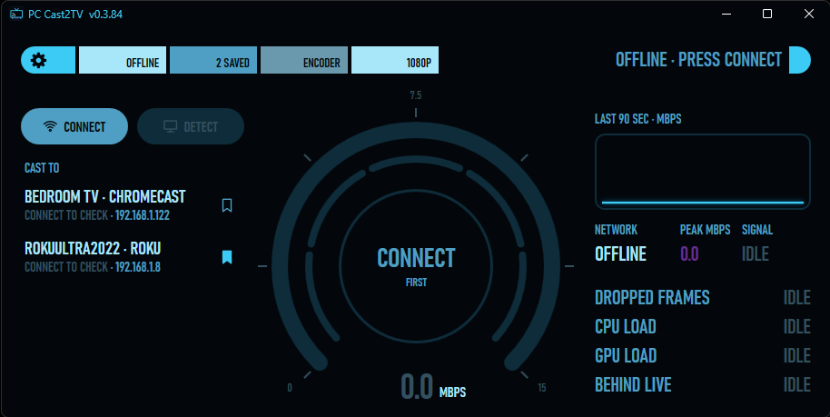

<h1 align="center">PC Cast2TV</h1>

  <b>Cast your Windows PC's screen and sound to your TV or Roku, over your home network.</b> 
  <b>Roku, Chromecast and smart TVs. Press Connect, pick your device, press Cast. That's the app.</b>

  
  &nbsp;&nbsp;&nbsp;
  
  &nbsp;&nbsp;&nbsp;
  

---

  

## Why this exists

I wanted my PC screen to show on my TV. The whole screen, with sound, smooth, without running an HDMI cable across the room or buying another gadget. The ways I tried either lagged, stuttered, or needed extra hardware. So with the help of Claude AI, I built exactly what I wanted: one small app, one button, and the TV shows what my PC shows. Hopefully it's what you've wanted, too.

## What it does

- **Casts your main screen and your PC's sound** at up to 1080p and 60 frames a second. Bigger screens are scaled down to fit.
- **Uses your graphics card's video encoder** (NVIDIA, AMD or Intel), so casting barely touches your processor. If the card's encoder won't start, the processor takes over at 30 frames a second.
- **Casts to:**
  - **Rokus:** Roku streaming sticks and boxes, and Roku TVs (through the free PC Cast2TV Roku app below).
  - **TVs with Chromecast built in:** many VIZIO, Sony, TCL and Hisense TVs, plus Chromecast dongles and Google TV boxes. No extra app needed.
  - **Other smart TVs** that can play video from your home network (DLNA).

  Not sure about yours? Just press Detect. If your TV shows up in the list, the app can cast to it.
- **One portable exe.** No installer, no extra programs, nothing running in the background. Its settings live in a `Settings` folder next to the app.
- **Keeps itself up to date.** When a new version is out, the app offers it when you open it. One click and it updates and restarts itself. It never interrupts a cast.
- **Your Roku remote works the PC:** Play/Pause, Next and Previous control whatever is playing on the PC, Fast Forward and Rewind send the arrow keys, and Back ends the cast.
- **A health readout** while you cast: dropped frames, CPU load, GPU load, and how far behind live the TV is. The numbers stay up after the cast so you can see how it went.
- **8 color themes,** plus Random and your own color, from the ⚙ cog. Settings also shows your version and links back to this page.

## Requirements

- **Works on Windows 10 and Windows 11** (64-bit). It looks best on Windows 11, where the title bar picks up your theme color and the window gets rounded corners.
- **The PC and the TV on the same home network.** Windows has to call that network Private, not Public. The app tells you if it doesn't.
- **Running a VPN?** If you're having connection issues, you may need to turn on its "Allow LAN" setting (some VPNs call it "Local network sharing") so the PC can reach the TV.

## Installing

1. Download **`PC-Cast2TV.exe`** from the [Releases](../../releases) page. That's the only official download. Copies posted anywhere else aren't from me, so don't run them.
2. Put it in its own folder (it keeps its `Settings` folder next to it) and run it. **Windows will show a blue "Windows protected your PC" warning.** That's SmartScreen reacting to an unsigned open-source app with no download reputation yet, not a threat detection. Click **More info → Run anyway**. (Don't take my word for what the app does. The entire source code is this repository.)
3. Press **Connect**. The first time, Windows asks once to let your TVs and Roku reach the app. That's a firewall rule for this app only, on private networks only.
4. Press **Detect** to find your TVs and Roku, click the one you want, and press **Cast**.

## Roku: install the PC Cast2TV Roku app

A Roku plays your PC through its own PC Cast2TV app. Until that app is in the Roku Channel Store, it installs through Roku's developer mode, which is free and built into every Roku:

1. Download **`PC-Cast2TV-Roku-v0.1.11.zip`** from the [Releases](../../releases) page.
2. Turn on developer mode. On the Roku remote, press **Home 3 times, Up 2 times, then Right, Left, Right, Left, Right**. Accept the agreement, set a password, and let the Roku restart.
3. Open the Roku's IP address in a browser, upload the zip, and the PC Cast2TV app appears on the Roku. The browser asks you to sign in first: the user name is `rokudev` and the password is the one you just set. (The Roku shows its IP address on the developer mode screen, and anytime under **Settings > Network > About**.)

**Good to know:** a Roku holds one developer app at a time, so installing this one replaces any other developer app on it.

## What it's been tested on

So far it has run on:

- Two desktop PCs on Windows 11, both wired to the network: one with an AMD Radeon card, one with an NVIDIA RTX 5060 Ti.
- A Roku Ultra (Roku OS 15.3), on Wi-Fi.
- A VIZIO TV with Chromecast built in, wired.

Not tested yet:

- **Laptops,** especially ones with two graphics chips.
- **Intel graphics** (the app supports Intel's video encoder, but no Intel card has been tested).
- **A Windows 10 PC.**
- **A PC on Wi-Fi.** (The Roku on Wi-Fi works fine.)
- **DLNA smart TVs.** The app supports them, but none have been tested.
- **Other Rokus** (Roku TVs, Express, Streaming Stick) and **Chromecast dongles or Google TV boxes.**

If it works, or doesn't, on your setup, please open an [Issue](../../issues) with your `debug.log`. That's how this list gets shorter.

## FAQ

**Why is the TV a few seconds behind my PC?**
Roku and Chromecast play the cast in one-second pieces and keep a few of them in hand, about 5 to 6 seconds on a Roku, so a Wi-Fi hiccup never freezes the picture. The health readout shows exactly how far behind it is.

**Why did my screen switch to 60 Hz?**
A 75 or 144 Hz screen copied 60 times a second can't land evenly on a 60 Hz TV, which shows as a stutter. So while you cast, the app runs your screen at 60 Hz, and it puts your screen back the way it was when the cast ends.

**It says the TV isn't answering.**
Make sure the TV (or the Roku) is on and on the same home network as the PC. If you run a VPN, turn on its "Allow LAN" setting. If the TV moved to a new address, press Detect to find it again.

**Can I hide a device I don't use?**
Right-click it in the list to hide it from the list or forget it from Detect. Right-click Detect to bring hidden devices back.

## Your data stays yours

This app collects **nothing** and sends **nothing** about you: no telemetry, no analytics, no accounts. It talks to your TVs on your home network, and its only internet use is asking this repository whether a newer version is out (and downloading it if you say so). That request sends nothing about you or your PC.

## Found a bug?

Open an [Issue](../../issues). Include the `debug.log` file from the `Settings` folder next to the app. It records what the app was doing, how each cast went, and your TV's model and software version. It contains no personal information: user names and folder paths are swapped for short tags. Read it yourself first if you like.

---

**© 2026 TOA. Released under the [GNU GPLv3](LICENSE).** It's free forever, and every fork must stay free and open source too.

This software is provided "as is", without warranty of any kind, express or implied. You use it at your own risk. TOA is not liable for any damage to hardware, loss of data, or any other damages arising from the use of this software.
