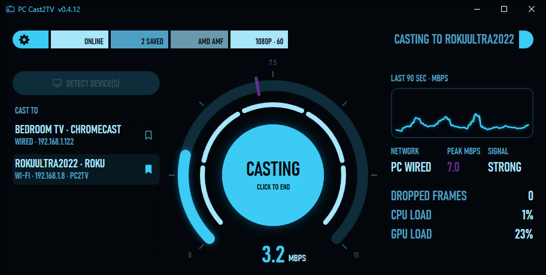
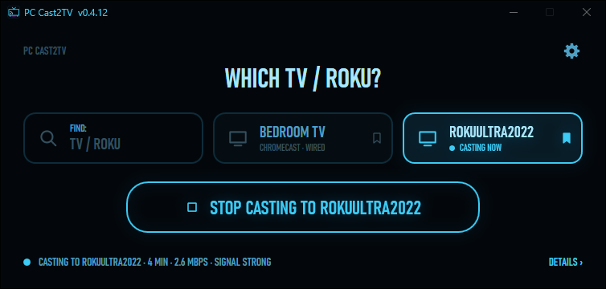
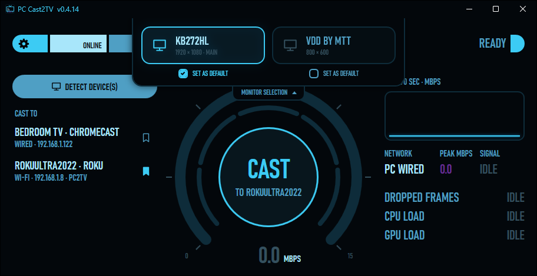
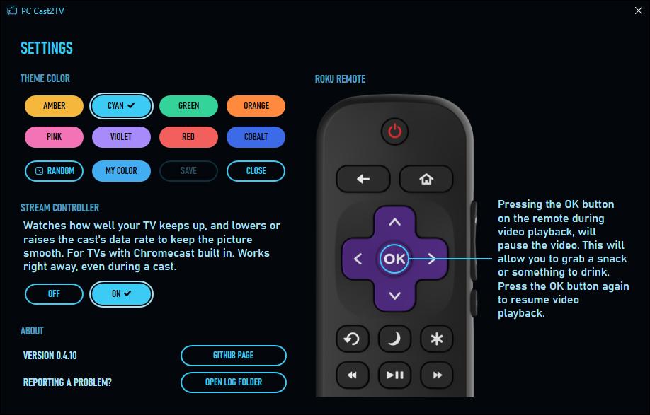
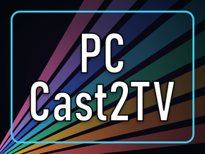

<h1 align="center">PC Cast2TV</h1>

  <b>Cast your Windows PC's screen and sound to your TV or Roku.</b> 
  <b>Open it, pick your TV, click Cast. That's the app.</b>

  
  &nbsp;&nbsp;&nbsp;
  
  &nbsp;&nbsp;&nbsp;
  

---

  

## Why this exists

I wanted my PC screen on my TV, with sound, smooth, and without an HDMI cable across the room or another gadget. Everything I tried lagged, stuttered or needed extra hardware. So with the help of Claude AI, I built what I wanted: one small app, one button, and the TV shows what my PC shows. Hopefully it's what you've wanted, too.

## What it does

- **Casts your screen and sound** at up to 1080p and 60 frames a second.
- **Uses your graphics card** (NVIDIA, AMD or Intel), so your processor stays free.
- **Casts to Rokus** (through our free Roku app), **TVs with Chromecast built in**, and **smart TVs with DLNA**. Not sure about yours? Click **DETECT DEVICE(S)**. If it shows up, it works.
- **One portable exe.** No installer, nothing running in the background.
- **Updates itself** when you open it, never during a cast.
- **MONITOR SELECTION** for two or more monitors: pick the one to cast, or tick **SET AS DEFAULT**. With one monitor, you won't see it.
- **Two looks:** the dial (above) or the simple look. The simple look's **DETAILS** page shows where a stutter comes from.
- **Settings** (the ⚙ cog): 8 color themes, a stream controller for Chromecast TVs, **PATCH NOTES** and your debug log.

  
  &nbsp;
   
   
  <i>The simple look · MONITOR SELECTION · Settings. Click any picture to see it full size.</i>

## What you need

- **Windows 10 or 11** (64-bit).
- **Your PC and TV on the same home network,** set to Private in Windows. The app tells you if it isn't.
- **Using a VPN?** Turn on its "Allow LAN" setting.

## Installing

1. Download **`PC-Cast2TV.exe`** from [Releases](../../releases). That's the only official download.
2. Put it in its own folder and run it. Windows shows a blue **"Windows protected your PC"** warning because the app is new, not because it found a threat. Click **More info → Run anyway**. (All the code is right here.)
3. The first time, Windows asks once to let your TV reach the app. Click **Yes**.
4. Click **DETECT DEVICE(S)**, click your TV, then click **Cast**.

## Roku

  

A Roku plays your PC through **PC Cast2TV for Roku**, our free app in the Roku Channel Store.

1. Click your Roku in PC Cast2TV.
2. Don't have the Roku app yet? Click **ADD PC CAST2TV** and its page opens on your TV.
3. Press **OK** on your Roku remote. That's it, you're ready to cast.

You can also search the Roku Channel Store for **PC Cast2TV**.

Newer Rokus set **Control by mobile apps** to **Limited**. If yours is, the app shows you where to switch it to **Enabled**.

**While casting:** press **OK** on the remote to pause or play the video on your PC. Press **Back** to end the cast.

The Roku app's code is in the [Roku App](Roku%20App) folder.

## Tested on

- Windows 10 and 11 desktops, wired, with AMD Radeon and NVIDIA RTX cards.
- A Roku Ultra and a TCL Roku TV, on Wi-Fi.
- A VIZIO TV with Chromecast built in.

**Not tested yet:** laptops, Intel graphics, a PC on Wi-Fi, DLNA TVs, other Rokus, Chromecast dongles, and two real monitors. Tried it on one of these? Open an [Issue](../../issues) with your `debug.log`, works or not.

## FAQ

**Why is the TV a few seconds behind?**
A Roku keeps a few seconds of video in hand, so a Wi-Fi hiccup never freezes the picture. A Chromecast TV is about half a second behind.

**Why did my screen switch to 60 Hz?**
So the cast lines up with your 60 Hz TV without stutters. It switches back when the cast ends.

**It says the TV isn't answering.**
Make sure the TV is on and on the same network as your PC, then click **DETECT DEVICE(S)** again.

**My Roku won't start the cast.**
On the Roku, go to **Settings > System > Advanced system settings > Control by mobile apps** and pick **Enabled**.

**Can I hide a device?**
Right-click it and click **HIDE FROM THE LIST**. Right-click **DETECT DEVICE(S)** to bring it back.

## Your data stays yours

No telemetry, no analytics, no accounts. The app talks only to your TVs at home, and checks this page for a new version. That check sends nothing about you.

## Found a bug?

Open an [Issue](../../issues) and add your `debug.log` (click the cog, then **OPEN LOG FOLDER**). It shows what the app did, with user names and folder paths taken out.

---

**© 2026 TOA. Released under the [GNU GPLv3](LICENSE).** It's free forever, and every fork must stay free and open source too.

This software is provided "as is", without warranty of any kind, express or implied. You use it at your own risk. TOA is not liable for any damage to hardware, loss of data, or any other damages arising from the use of this software.
